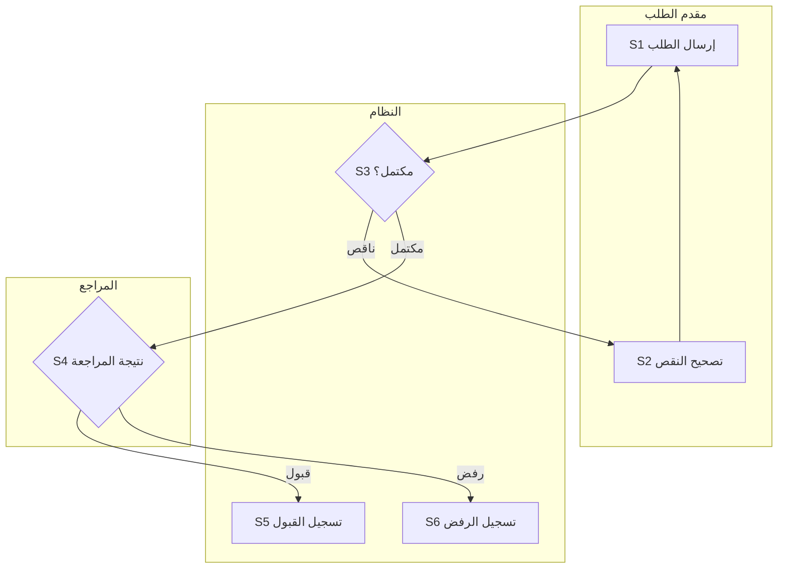

# العملية ومسارات المسؤولية — {{PROC-id / الاسم}}

> املأ البطاقة والرسم وجدول الخطوات بنسخة متسقة. افصل As-is وTo-be عند وجودهما. المثال أدناه تعليمي فقط، وليس سياسة مشروع أو رسم BPMN رسميًا.

## 1. حدود العملية والأدلة

وحدة الحالة {{…}}؛ هدفها {{…}}؛ المحفز {{…}}؛ البداية والنهايات {{…}}؛ الجهات والمسارات {{…}}؛ المالك وصاحب القرار {{…}}؛ المصدر/الإصدار {{…}}؛ الوضع وحالة الاعتماد {{…}}.

## 2. سجل الخطوات المرجعي

| معرف الخطوة | المنفذ والفعل | المدخل ← المخرج/الحالة | الشرط والمسار التالي | القاعدة/المتطلب/UC |
|---|---|---|---|---|
| {{STEP-id}} | {{…}} | {{…}} | {{…}} | {{…}} |

نقاط الانتظار والتبادل الخارجي ومعرف الربط {{…}}؛ مسؤول المتابعة {{…}}؛ شروط التوازي/الجمع إن وجدت {{…}}؛ الغموض المؤثر {{…}}.

## 3. مثال رسم مسؤوليات مبسط قابل للتعديل

افتراضات المثال: اكتمال الطلب يُفحص قبل المراجعة؛ النقص يعاد للتصحيح؛ قرار المراجع قبول أو رفض. ظروف أخرى غير ممثلة. استبدل المثال بالكامل بنطاق المشروع ولا تنقل أحكامه.

السهم يبين انتقال العمل في هذا الرسم التوضيحي؛ العقدتان S5 وS6 نهايتا النطاق المبسط. subgraphs تجميع مسؤوليات وليست ضمانًا لمحاذاة Swimlanes ثابتة. عند طلب محاذاة رسمية استخدم أداة مناسبة ومصدرًا قابلًا للتحرير.

## 4. المشي عبر المسارات والأثر

| الحالة المختارة | تسلسل معرفات الخطوات | شروط ونتيجة متوقعة | تطابق النص/الرسم أو فجوة |
|---|---|---|---|
| {{نجاح/إرجاع/رفض/فشل/توازي}} | {{…}} | {{…}} | {{…}} |

تغيير As-is إلى To-be {{خطوة محفوظة/معدلة/مدمجة/ملغاة بمصدر}}؛ الأثر على الضوابط والمتطلبات {{…}}؛ مصدر الرسم القابل للتحرير {{…}}؛ حالة فحص المنطق/التصيير {{…}}.

- [ ] الخطوات والمسؤوليات والحراس والنهايات متطابقة مع النص ومصدرها.
- [ ] مسار العودة مفهوم، والجمع لا ينتظر فرعًا لم يُفعّل.
- [ ] لا اعتماد جديد أو مهلة أو تصعيد أو تغيير صلاحية بلا مصدر.
- [ ] حدود الرسم ومفتاحه والتحقق الفعلي معلنة، والعربية والأسهم مقروءة إن صُيّر.
