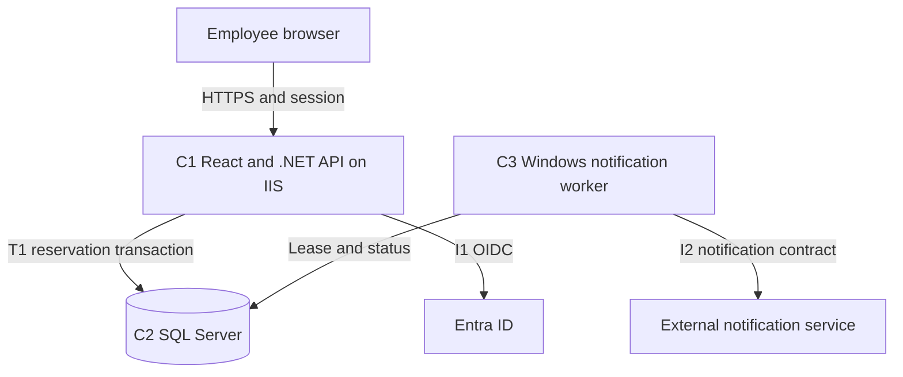

# Worked custom solution: room reservations

**ILLUSTRATIVE EXAMPLE — fictional requirements and proposed design, not an EF
project, approved policy, deployed topology or executed test.** Use this compact
SAD/SDD with embedded HLD and full LLD for its deliberately bounded scope to
calibrate specificity. Derive real designs from their own sources.

## Contents

- [Requirements and scope](#requirements-and-scope)
- [Decisions and HLD](#decisions-and-hld)
- [Data LLD](#data-lld)
- [Operation LLD](#operation-lld)
- [Channel and runtime LLD](#channel-and-runtime-lld)
- [Capacity, transition and evidence](#capacity-transition-and-evidence)

## Requirements and scope

| ID | Fictional requirement |
| --- | --- |
| R1 | Signed-in employees reserve a single room for an exclusive UTC interval; end must be after start |
| R2 | Active intervals in the same room cannot overlap; a booking ending at another's start is allowed |
| R3 | The owner can change or cancel their booking; another employee cannot mutate or view its private details |
| R4 | A lost response/repeated command must not create a second business effect |
| R5 | Send a confirmation asynchronously; booking success remains valid if notification delivery fails |
| R6 | Display room availability and the current user's bookings; concurrent changes must be visible as conflicts |
| Q1 | Preserve accepted bookings through web/worker process restart; site-loss RPO/RTO are undecided |

Scope includes availability, create/read/change/cancel, notification and audit.
Recurring bookings, guests, approvals, uploads and room administration are outside
this example. Assumed identity input: Entra OIDC subject identified by tenant/object
ID. No emergency local account is inferred. Named decision owners are roles:
service owner, identity owner, DBA, developer and operations owner.

## Decisions and HLD

| ADR | Decision and serious alternative | Reason, downside and revisit |
| --- | --- | --- |
| D1 | Modular monolith, not independently deployed booking services | One transaction owns overlap rules; fewer operational boundaries. Revisit for independent ownership/load, not folder count |
| D2 | React static SPA + .NET BFF/API on IIS | Meets custom track and interactive internal scope. No server-rendering need established; BFF/session adds CSRF/key-management responsibilities |
| D3 | SQL Server authoritative reservations, not cache authority | Constraints and serialized room writes enforce invariants; hot room writes serialize. Measure contention before changing design |
| D4 | Transactional notification intent + independent .NET Windows worker | Acceptance survives IIS recycle. Alternative mature scheduler with SQL storage remains viable if operations needs justify its dependency/license costs |
| D5 | Latest supported compatible versions selected after manifest/OS inspection | Exact versions are open, not silently invented; logical contracts remain implementable while compatibility is verified |

C1 owns room and reservation use cases and resource authorization. C2 holds
authoritative business/audit/delivery data; a shared instance does not authorize
arbitrary cross-module writes. C3 owns delivery execution, not booking policy.
I1 has identity-owner verification; I2 needs provider authentication, idempotency
and status capabilities confirmed. Both external systems are outside delivery scope.
Topology separates web and worker lifecycle; placement/failure domains remain an
operations decision, so this diagram does not claim HA.

## Data LLD

The following is an illustrative logical/physical contract, not executable DDL.
GUIDs serialize as strings; versions as base64; UTC instants as ISO 8601 strings.

| Entity | Fields and keys | Constraints/index purpose |
| --- | --- | --- |
| Room | RoomId uniqueidentifier PK; Name nvarchar(120) required; Enabled bit required; Version rowversion | Name is display data, not identity; PK supports per-room serialization |
| Booking | BookingId uniqueidentifier PK; RoomId FK; OwnerTenantId/OwnerObjectId uniqueidentifier required; StartUtc/EndUtc datetime2(7); State varchar(12); Version rowversion; CreatedUtc/UpdatedUtc datetime2(7) | State Active/Cancelled; EndUtc > StartUtc; index (RoomId,State,StartUtc) includes EndUtc for overlap; owner/time index for My Bookings |
| CommandReceipt | CallerTenantId/CallerObjectId/CommandId uniqueidentifier required; RequestHash binary(32); Operation varchar(20); BookingId uniqueidentifier nullable; OutcomeCode varchar(40); ResultVersion binary(8) nullable; ResponseJson nvarchar(max); CreatedUtc datetime2(7) | Unique caller + CommandId; request hash includes operation/path/body/precondition; durable result enables safe replay |
| NotificationIntent | IntentId uniqueidentifier PK; BookingId uniqueidentifier FK; BusinessVersion binary(8); EventKind varchar(20); RecipientTenantId/RecipientObjectId uniqueidentifier; PayloadSnapshot nvarchar(max); Status varchar(20); Attempts int; NextAttemptUtc datetime2(7); LeaseUntilUtc datetime2(7) nullable; LeaseToken uniqueidentifier nullable; ProviderReference nvarchar(200) nullable | Created atomically with booking; unique BookingId + business version + EventKind; ready-work index; terminal outcomes retained for reconciliation |
| AuditEvent | EventId uniqueidentifier PK; ActorTenantId/ActorObjectId uniqueidentifier; Action varchar(20); BookingId uniqueidentifier; CommandId uniqueidentifier; Result varchar(40); OccurredUtc datetime2(7) | Business audit written with successful mutation; denied actions logged without private booking content |

All fields are required unless marked nullable. Text bounds are fictional example
choices, not EF standards. JSON payloads have a versioned application schema;
nullable lease fields are set only while InProgress and cleared on terminal/retry
transition. Attempts is nonnegative. Room and Booking deletion is restricted while
referenced; no physical deletion operation is exposed in this scope.

Retention periods are open to the service/data owner. Command-result retention
must cover the promised retry horizon; deleting receipts while accepting old
keys can re-enable duplicate effects. Do not invent a lifetime. Store notification
recipient/content as the authorized event snapshot and minimize personal data.

T1: all reservation writes first serialize through the same Room row using a
transaction-held database update lock, then validate active overlap and modify
booking/receipt/audit/intent atomically. Overlap predicate: existing.Start < new.End
and existing.End > new.Start, excluding the current booking during changes.
Every write path, including administrative future paths, must follow this rule.
If moving rooms is added, lock room IDs in a deterministic order; currently it is
out of scope. No HTTP or user wait occurs inside T1.

Command-key uniqueness is database enforced. Competing identical keys serialize
or one loses the unique insert; reload the committed receipt and compare its
hash instead of treating the uniqueness exception as successful execution.
Deadlock replay is bounded and retries the whole rolled-back unit with the same
command/version. A lost response after commit is resolved through the receipt.

## Operation LLD

All operations derive caller identity from the verified session. Routes do not
accept OwnerSubject from JSON. UTC range queries require bounded pagination;
maximum query range is a proposed policy needing service-owner confirmation.

| ID/API | Inputs/precondition | Rule, result and error contract |
| --- | --- | --- |
| O1 GET /rooms/{id}/availability | UTC start/end, cursor | Return active busy intervals only, with no owner/title; snapshot may become stale before booking |
| O2 POST /bookings | CommandId header; roomId,startUtc,endUtc | T1 validates room enabled, interval and no overlap; 201 with id/version; 409 RoomUnavailable; 422 InvalidInterval |
| O3 GET /bookings/{id} | Session owner | Return own booking/version; 404 for inaccessible/nonexistent; no enumeration of another owner's details |
| O4 PATCH /bookings/{id} | CommandId and If-Match; start/end | Owner + Active + original version; T1 rechecks overlap; 200 new version; 412 stale version; 409 invalid state |
| O5 POST /bookings/{id}/cancel | CommandId and If-Match | Owner + original version; T1 transitions Active to Cancelled and records notification; new-key repeat on already Cancelled returns defined no-change state without another intent |
| O6 GET /me/bookings | State/time filters, cursor | Server derives owner; stable order with ID tie-breaker; bounded result, no cross-user query parameter |

Wire schema details: BookingView contains id and roomId (UUID strings), startUtc
and endUtc (UTC date-time strings), state (Active/Cancelled), version (base64
8-byte token) and updatedUtc (UTC date-time). Creation uses roomId/startUtc/endUtc;
change uses startUtc/endUtc. Cancel has no mutable body. BookingView omits owner
identifiers because it is an authorized self view. Availability returns roomId,
intervals[{startUtc,endUtc}] and nextCursor:string|null; MyBookings returns
items:BookingView[] and nextCursor:string|null. No field is omitted in place of
null. Every successful command stores its operation-specific response schema.

Illustrative O2 request: `{"roomId":"9f710351-6e27-4a93-b402-714c41078839",
"startUtc":"2030-01-10T09:00:00Z","endUtc":"2030-01-10T10:00:00Z"}`.
The synthetic date/ID is not a live record. Headers carry the stable command ID;
O4/O5 require the quoted strong ETag derived from the returned version. Invalid
version encoding gives 400; absent required precondition gives 428; mismatch
gives 412 with no mutation. O5 returns BookingView with Cancelled state.

Unauthenticated requests return 401. Validation errors use a consistent Problem
Details contract: type/title/status, stable business code, traceId and field errors
where appropriate. Never return stack traces, SQL or private values. Replayed
commands return their original logical result only after current access is checked;
same key with different payload/path/version gives 409 CommandKeyConflict.

R4 requires UI to retain a command ID for the same user intent. A new deliberate
operation gets a new key. Disabling a button is feedback, not duplicate protection.
An unknown result must be reconciled by replay/status before offering a new submit.

Notification state: Pending → InProgress → Delivered, RetryDue or NeedsReview.
C3 atomically leases due intents and uses a lease token to fence status writes;
expired leases are recoverable. At-least-once execution may send twice if the
provider has no deduplication/status contract. Use stable IntentId with I2 when
supported; otherwise keep timeout-after-send as NeedsReview and reconcile before
replaying consequential effects. Worker crash before acknowledgement is tested.
This design does not assert exactly-once email delivery.

## Channel and runtime LLD

React routes: /rooms for availability and reservation, /bookings for owned list,
/bookings/:id for details/change/cancel. Feature boundaries match O1–O6. Use one
query/cache owner for server data; local form state owns dirty edits; URL owns
filters. Query keys include authenticated subject and resource/filter scope.
On logout/account change cancel outstanding requests and discard private caches.
Do not copy all query results into a second global store.

Represent loading, empty, denied, validation, conflict, submitting, uncertain
result and success explicitly. A stale availability result does not confirm a
reservation. On 409 preserve the form and refresh available intervals; on 412
show current and attempted values for a deliberate retry. Refetch must not
overwrite dirty inputs. Provide Arabic RTL, labels, focus/error announcements,
keyboard interaction and visible pending/result states; UX owns visual styling.

Identity design: OIDC authorization code flow at the .NET BFF; protected session
cookie, anti-CSRF for mutations, constrained redirect URLs, persistent protected
Data Protection keys and rotation ownership. Tokens are not kept in browser
local storage. Availability is an intentionally limited projection; mutation
and private reads authorize the current owner server-side.

C1/C3 run with separate limited identities; migration privileges are separate.
SQL and provider secrets use authorized configuration sources, not this document.
Configuration contracts: provider endpoint/credential reference; lease and retry
settings; request/query limits; log redaction and retention. Values are validated
by the implementing team, with no production defaults invented here.

Liveness reports process health; readiness reflects dependencies needed for the
particular endpoint. Provider failure does not make booking acceptance fail when
intent can persist. Observe booking conflict/error latency, SQL blocking/deadlocks,
intent age/failure/unknown outcomes and worker health. Audit remains separate from
diagnostics. No PII in metric labels; correlation joins requests, T1 and I2.

## Capacity, transition and evidence

Illustrative queue calculation: if 100 intents accumulate and arrivals average
2/s while sustained completion is 7/s, drainage is 100/(7−2)=20 seconds. This is
an average-rate calculation, not a measured percentile or proof of provider quota.
Measure peak/skew, hot-room locks, retention/index growth and provider limits.
Costs include web/worker, SQL licensing/storage/backup, monitoring, delivery fees
and maintenance of the chosen dispatch mechanism; use actual quotes before totals.

Release by one representative booking slice, then O4/O5, then notification/recovery
and the full UI. Schema changes must support overlapping deployments; do not
contract/remove columns before old hosts are drained. Receipt/hash rules remain
compatible with previous clients. Rollback of binaries does not undo notifications.

| Requirement | Decision/component/contract | Acceptance scenario and evidence owner |
| --- | --- | --- |
| R1–R2 | D1/D3, C1/C2, T1/O2/O4 | Separate SQL connections submit overlapping intervals simultaneously: at most one succeeds; adjacent intervals succeed; developer/DBA |
| R3 | C1, O3–O6 | Different subject, forged owner, guessed ID and direct API attempts reveal no private data or mutation; developer/security |
| R4 | CommandReceipt, O2/O4/O5 | Response lost after commit, parallel same key, same key changed body: one effect and deterministic result/conflict; developer |
| R5 | D4, C3/I2 | Kill before/after provider call; reconcile unknown outcome, no false completion; integration/operations |
| R6 | React/O1–O6 | Conflict, dirty-form refetch, logout during request and back navigation preserve correct state; frontend/UX |
| Q1 | C2/C3 | Kill web/worker and restart; accepted booking/intent survives; timed database restore and business reconciliation are separate operations evidence |

Design walkthrough covers all scoped use cases. Runtime checks were not executed.
Open items: exact versions and I2 semantics, volumes and numerical SLOs, retention,
site-loss RTO/RPO, actual hosting placement and recovery. Owners above resolve
them before making corresponding performance/recovery/production claims.
